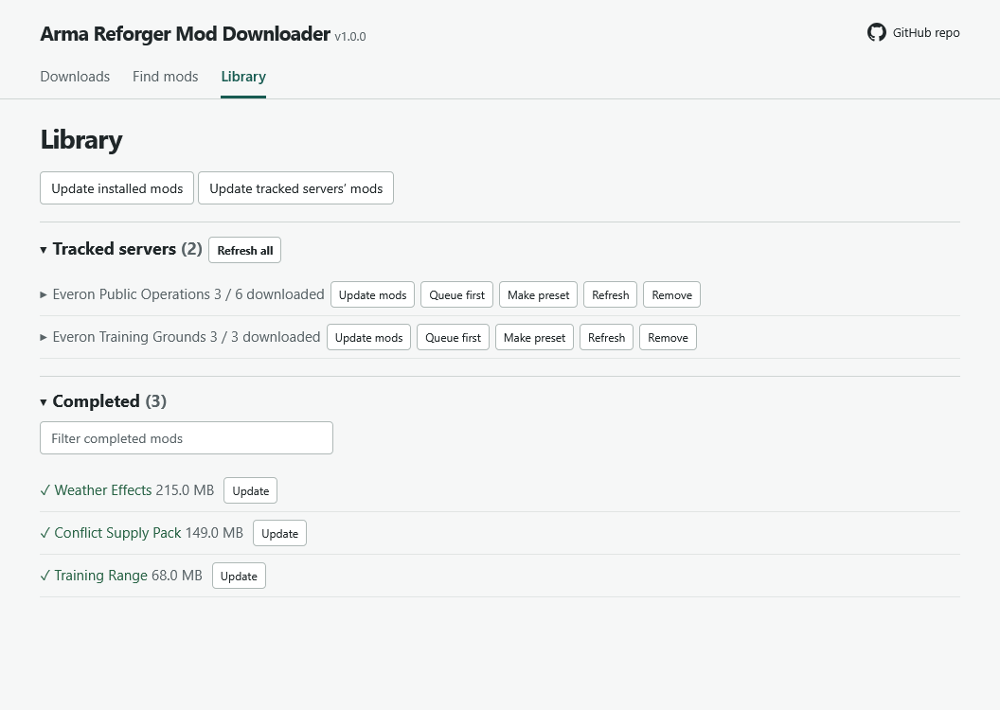

# Arma Reforger Mod Downloader

Queue a server's Arma Reforger Workshop mods before you join. You can also search for individual mods and resume paused downloads on Windows and Linux.

[Download for Windows x64](https://github.com/goxy701/arma-reforger-mod-downloader/releases/latest/download/ReforgerModDownloader.exe) · [Download for Linux x64](https://github.com/goxy701/arma-reforger-mod-downloader/releases/latest/download/ReforgerModDownloader-linux-x64.tar.gz) · [Project website](https://goxy701.github.io/arma-reforger-mod-downloader/) · [Releases](https://github.com/goxy701/arma-reforger-mod-downloader/releases/latest)

## Install on Windows or Linux

**Windows.** Run the EXE. The app looks for the dedicated server in your Steam libraries and downloader folders. For a standalone installation, choose its folder. To install the server, select **Install engine**. You'll need about 20 GB, plus room for mods. [WebView2 Runtime](https://developer.microsoft.com/microsoft-edge/webview2/)

**Linux.** Extract the archive and run `./ReforgerModDownloader`. Install PowerShell 7, SteamCMD, and the GTK 3 and WebKitGTK 4.1 Python bindings. On Ubuntu or Debian, install `python3-gi`, `gir1.2-gtk-3.0`, and `gir1.2-webkit2-4.1`. The app reuses a native dedicated server if it finds one.

## Download a server's mod list

Open **Find mods**, search for your server, and select **Add server**. Follow the queue under **Downloads**. To save a preset after the queue finishes, close the game and select **Make preset** under **Tracked servers**.

On Linux, set `RFMM_GAME_PROFILE` to the game's profile folder to share mods and save presets. For Steam Proton, this is usually `steamapps/compatdata/1874880/pfx/drive_c/users/steamuser/Documents/My Games/ArmaReforger` inside the game's Steam library. Set `RFMM_HOME` to change the engine folder or `RFMM_DATA` to change the queue and log folder.

[Build and tests](docs/TESTING.md) · [License](LICENSE)

## Screenshots

