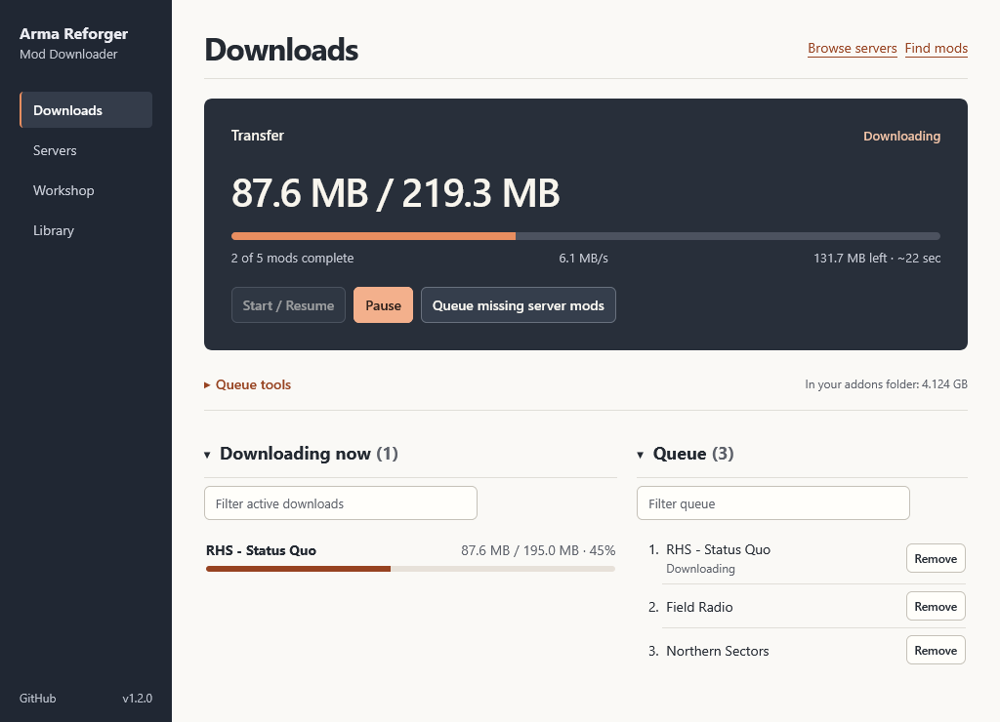

# Arma Reforger Mod Downloader

Browse Arma Reforger servers and Workshop mods, then queue downloads before you join. The desktop app runs on Windows and Linux.

You can download mods without installing the game. The downloader uses the free Arma Reforger dedicated server.

On Windows, mods download straight into the game's **Documents → My Games → ArmaReforger → addons** folder. The downloader creates it on first use. Use **Open addons folder** in the Downloads tab to find it.

[Download for Windows x64](https://github.com/goxy701/arma-reforger-mod-downloader/releases/latest/download/ReforgerModDownloader.exe) · [Download for Linux x64](https://github.com/goxy701/arma-reforger-mod-downloader/releases/latest/download/ReforgerModDownloader-linux-x64.tar.gz) · [Project website](https://goxy701.github.io/arma-reforger-mod-downloader/) · [Releases](https://github.com/goxy701/arma-reforger-mod-downloader/releases/latest)

## Install on Windows or Linux

**Windows.** Run the EXE. The app looks for the dedicated server in your Steam libraries and downloader folders. For a standalone installation, choose its folder. To install the server, select **Install engine**. You'll need about 20 GB, plus room for mods. [WebView2 Runtime](https://developer.microsoft.com/microsoft-edge/webview2/)

**Linux.** Extract the archive and run `./ReforgerModDownloader`. Install PowerShell 7, SteamCMD, and the GTK 3 and WebKitGTK 4.1 Python bindings. On Ubuntu or Debian, install `python3-gi`, `gir1.2-gtk-3.0`, and `gir1.2-webkit2-4.1`. The app reuses a native dedicated server if it finds one.

## Download a server's mod list

Open **Servers** to search by name or scenario and filter by region, platform, mod support, and more. Select a server to see its player history and exact reported mod versions. **Track & queue mod list** adds missing mods to **Downloads**. You can save a preset from **Library** after downloads finish and the game is closed.

Select **Join** in Servers or Library to open the server's Steam invite. Arma Reforger must be installed to play. **Measure regional ping** checks the directory's regional ping sites from your device.

**Workshop** searches by name, author, tag, or mod ID. Open an item for screenshots, dependencies, version history, and release notes. You can copy mod-list JSON from Workshop and server details.

The packaged app's **Uninstall** menu can remove the downloader with or without the dedicated server it installed. Both options keep your game mods and presets.

The app checks for mod updates when it opens. In **Library**, choose **Update all** or update individual mods as they appear. Recent Workshop releases show up first. A full check can take longer for large libraries.

On Linux, the desktop app finds the game's Steam Proton profile. Its default is `steamapps/compatdata/1874880/pfx/drive_c/users/steamuser/Documents/My Games/ArmaReforger` inside the Steam library. Set `RFMM_GAME_PROFILE` for a custom profile, `RFMM_HOME` for the engine folder, or `RFMM_DATA` for the queue and log folder.

[Build and tests](docs/TESTING.md) · [License](LICENSE)

## Screenshots

