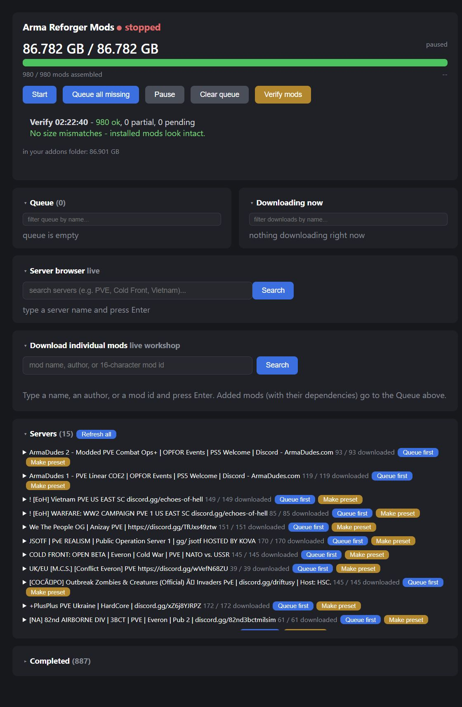

# Arma Reforger Mod Downloader

**Download Arma Reforger Workshop mods on Windows.** Grab an entire server's mod
list, or single mods found by name, author, or mod id. Dependencies come with
them. Everything lands in your game's `addons` folder, ready for the launcher.

No Steam account. No game launch. One-click setup.



`Windows 10/11` · `Windows PowerShell 5.1` · `MIT` · [latest release](../../releases/latest)


## Contents

- [What it does](#what-it-does)
- [Requirements](#requirements)
- [Install](#install)
- [Download a whole server's mods](#download-a-whole-servers-mods)
- [Download individual mods](#download-individual-mods)
- [Progress and file checks](#progress-and-file-checks)
- [Launcher presets](#launcher-presets)
- [Where your files go](#where-your-files-go)
- [FAQ](#faq)
- [Troubleshooting](#troubleshooting)
- [Advanced settings](#advanced-settings)
- [Uninstall](#uninstall)
- [How it works](#how-it-works)

## What it does

- **A whole server at once.** Search the live server browser, press *Add server*,
  and every mod that server runs is queued.
- **Single mods.** Search the Workshop by mod name, author name, or the
  16-character mod id, and add only what you want.
- **Dependencies included.** If a mod needs other mods, they are queued with it
  and marked as dependencies, so the size total is honest.
- **Downloads straight to the game.** Finished mods are copied into
  `Documents\My Games\ArmaReforger\addons`, which is the folder the game reads.
- **Verification.** Every mod is checked against the file list inside the mod
  itself, so a half-finished download is never counted as installed.
- **Launcher presets.** Write a preset for a server, containing exactly the mods
  of that server you have installed.

## Requirements

- Windows 10 or 11.
- Arma Reforger installed (the tool writes into its `addons` folder).
- About 2 GB free for the download engine, plus room for the mods.
- An internet connection.

## Install

1. Open [Releases](../../releases/latest) and download the newest `.zip`.
2. Right-click the zip, choose **Extract All**, and put the folder anywhere
   (Desktop is fine). Do not run it from inside the zip.
3. Double-click **`1 - Setup.cmd`** and wait for `Ready.`
4. Double-click **`Start Mods Download.cmd`**.

A browser opens at `http://localhost:8123/`. Keep the window that opened next to
it open while you download; that window is the program. Close it when you are
done.

If Windows shows *"Windows protected your PC"*, click **More info**, then **Run
anyway**. That message appears because the files are new and unsigned.

### What setup installs

Setup downloads SteamCMD, then the free Arma Reforger dedicated server, about
1.4 GB in total, once. The tool uses that server as its download engine.

It needs an engine because **the Workshop has no public download link**. Mod files
are served only to a signed-in game or to the dedicated server. The server
installs with Steam's anonymous login, so no account is created or used.

## Download a whole server's mods

1. In **Server browser**, type part of a server name and press Enter.
2. Press **Add server** on the one you want. Its mods are appended to the queue.
3. Press **Start**.

Each mod is downloaded, checked file by file, then copied into your addons
folder. Mods you already have are skipped.

## Download individual mods

1. In **Download individual mods**, type one of these and press Enter:

   | Search by | Example |
   | --- | --- |
   | Mod name | `Project Redline` |
   | Author name | `ekudmada` |
   | Mod id (from a workshop link) | `5E0210B8D9ACE179` |

2. Press **Add** on a result. The mod and its dependencies join the Queue above.
3. Press **Start**.

Results show the author, the version, and the download size. Mods you already
installed are marked *installed* instead of offering an Add button.

## Progress and file checks

| On screen | Meaning |
| --- | --- |
| `86.78 GB / 86.78 GB` | the size of the mods you picked, as they sit in your addons folder |
| `in your addons folder: 86.9 GB` | the addons folder itself, measured on disk |
| ⟳ on a queue row | that mod is downloading now |
| `mods assembled` | mods that passed the file check |

"Installed" means the addon's own file list matches the disk exactly. The tool
also waits until a mod has stopped changing for two minutes, because the engine
writes a mod's files at full size before it fills them.

**Pause** stops the engine and keeps everything downloaded so far. **Start**
continues. **Clear queue** empties the queue and never deletes files.
**Verify mods** re-checks everything against the Workshop.

## Launcher presets

Press **Make preset** on a server row. The tool writes a launcher preset with
that server's mods that you have installed, and verifies the result.

Close the game first: it rewrites its settings file on exit.

## Where your files go

| What | Where |
| --- | --- |
| Mods (read by the game) | `Documents\My Games\ArmaReforger\addons` |
| Download engine | `armar-server\` in the tool's folder |
| Working copy of downloads | `serverprofile\` in the tool's folder |
| Saved lists and sizes | `data\` in the tool's folder |
| What you clicked, and when | `data\actions.log` - one line per button press |

Deleting the tool's folder does not touch your installed mods.

## FAQ

**Do I need to own Arma Reforger?**
Yes. The tool installs mods for a game you own; it does not include the game.

**Do I need a Steam account?**
No. Setup uses Steam's anonymous login to fetch the free dedicated server.

**Can I download Workshop mods without launching the game?**
Yes. That is the point: download first, start the game afterwards.

**Why does it install a server?**
Because the Workshop does not offer direct file downloads. The dedicated server
is the official way to fetch a mod's files without a signed-in game client.

**Will it download the same mod twice?**
No. A mod is skipped when its own file list already matches what is on disk.

**Can I queue several servers?**
Yes. *Add server* appends each server's missing mods. *Refresh all* re-reads every
tracked server and queues what is new.

**Does it work on Linux or macOS?**
No. It is a Windows PowerShell tool and writes to the Windows game folder.

**Where do I find a mod id?**
Open the mod on the Workshop; the id is the 16 characters at the end of the link.

## Troubleshooting

**Setup fails.** Run `1 - Setup.cmd` again; the download resumes. Check that you
are online and have ~2 GB free.

**Nothing opens in the browser.** Type `http://localhost:8123/` into the address
bar.

**A mod never finishes.** The Workshop sometimes refuses a single mod. The tool
skips it after three refusals and names it on the page. Remove it and continue.

**A mod does not show up in the game.** Open the addons folder and look for a
folder ending in that mod's id. If it is missing, press Start again; only the
missing mods are fetched.

**Antivirus flags `Start Mods Download.cmd`.** It is a one-line file that starts
PowerShell. Every `.ps1` file here can be opened in Notepad and read.

## Advanced settings

Two environment variables move the big folders (optional):

```
set RFMM_HOME=D:\reforger\home     REM engine + working copy
set RFMM_DATA=D:\reforger\data     REM saved lists and sizes
```

Set them in the same window you start the tool from.

## Uninstall

Delete the tool's folder. That removes the engine and its working copy.

Your mods stay in `Documents\My Games\ArmaReforger\addons`. Remove the folders
you no longer want.

## How it works

The tool writes a config for the dedicated server that lists exactly the mods you
picked, starts it headless, and watches its log and its output folder. When the
engine finishes, the tool checks each mod against its own file list and mirrors
the finished folders into the game's addons folder with `robocopy /MIR`.

Search and sizes come from the public [reforgermods.net](https://reforgermods.net)
API. Downloads come from the official Workshop through Steam. Nothing is
re-hosted, and the tool has no server or telemetry of its own.

## Related

- Development source and history: [arma-reforger-ai-toolkit](https://github.com/goranbalsic/arma-reforger-ai-toolkit) — the same downloader plus the tooling used to work on Reforger mods (publish, deploy, previews).
- Workshop search and sizes come from [reforgermods.net](https://reforgermods.net).
- The engine is the free [Arma Reforger dedicated server](https://developer.valvesoftware.com/wiki/Arma_Reforger:_Dedicated_Server).

## License

MIT. See [LICENSE](LICENSE).
