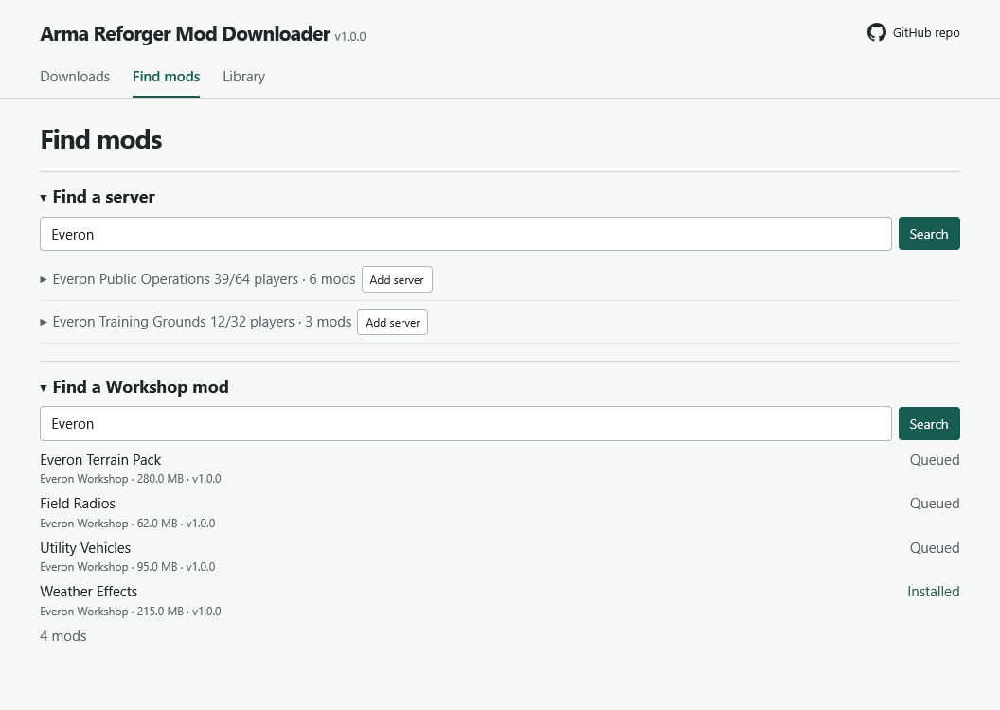

# Arma Reforger Mod Downloader

Download Arma Reforger Workshop mods on Windows and Linux before joining a multiplayer server. Queue a server's public mod list, search for individual mods, and resume downloads.

[Download for Windows x64](https://github.com/goxy701/arma-reforger-mod-downloader/releases/latest/download/ReforgerModDownloader.exe) · [Download for Linux x64](https://github.com/goxy701/arma-reforger-mod-downloader/releases/latest/download/ReforgerModDownloader-linux-x64.tar.gz) · [Project website](https://goxy701.github.io/arma-reforger-mod-downloader/) · [Releases](https://github.com/goxy701/arma-reforger-mod-downloader/releases/latest)

## Install on Windows or Linux

**Windows.** Run the EXE. If you already have the dedicated server in a Steam library or a downloader folder, the app opens automatically. To reuse a standalone server, choose its folder. If you need to install it, select **Install engine** and allow about 20 GB plus space for mods. [WebView2 Runtime](https://developer.microsoft.com/microsoft-edge/webview2/)

**Linux.** Extract the archive and run `./ReforgerModDownloader`. Install PowerShell 7, SteamCMD, and the GTK 3 and WebKitGTK 4.1 Python bindings. On Ubuntu or Debian, the window packages are `python3-gi`, `gir1.2-gtk-3.0`, and `gir1.2-webkit2-4.1`. The app reuses a native dedicated server if it finds one.

## Download a server's mod list

Open **Find mods**, search for your server, and select **Add server**. Watch the queue under **Downloads**. Once it finishes, close the game and use **Make preset** under **Tracked servers** to save a preset.

On Linux, set `RFMM_GAME_PROFILE` to the game's profile folder to share mods and save presets. For Steam Proton, this is usually `steamapps/compatdata/1874880/pfx/drive_c/users/steamuser/Documents/My Games/ArmaReforger` inside the game's Steam library. Set `RFMM_HOME` to change the engine folder or `RFMM_DATA` to change the queue and log folder.

[Build and tests](docs/TESTING.md) · [License](LICENSE)

## Screenshots

